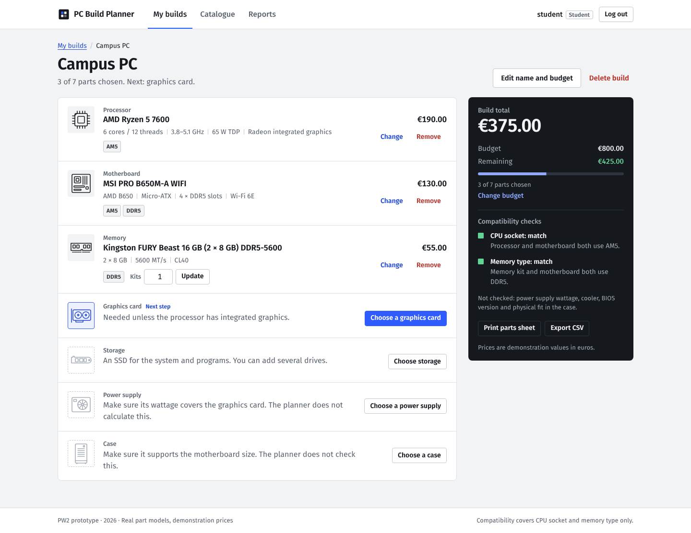

# PC Build Planner

a Vilnius University Practical Work II application for planning desktop PCs part by part. A build has seven slots (processor, motherboard, memory, graphics card, storage, power supply, case) filled from a catalogue of real components. The planner keeps the total against a budget and checks CPU socket and memory type against the motherboard. Catalogue prices are demonstration values.



## Run locally

Use Python 3.11 or newer. From the extracted project directory in PowerShell:

```powershell
py -m venv .venv
.\.venv\Scripts\python.exe -m pip install -r requirements-dev.txt
.\.venv\Scripts\python.exe setup_db.py
.\.venv\Scripts\python.exe -m pytest -q
.\.venv\Scripts\python.exe -m uvicorn app:app --host 127.0.0.1 --port 8000
```

Running `setup_db.py` again upgrades an older local database without losing builds.

Open http://127.0.0.1:8000. The local seed accounts are `student` and `admin`, both with password `demo12345`. In production, the bootstrap command creates separate accounts with random passwords; the application rejects a database containing the original default accounts during initialization.

## Features

- **Builder.** Each build shows seven slots in assembly order. An empty slot explains what to pick and opens the catalogue filtered to that slot. Filled slots show key specifications, price, Change and Remove. The next empty slot is highlighted.
- **Choosing parts.** In build context the catalogue shows whether each part fits the parts already chosen and what the total becomes. A filled slot offers Replace, which swaps the part in one step. Storage can hold several drives; memory kits and drives have quantities.
- **Budget and checks.** A summary panel shows total, budget, remaining or over amount, progress and both checks with the names of the parts involved. It does not check power supply wattage, cooling, BIOS or case fit, and says so.
- **Catalogue.** 27 real parts with key specifications. Search matches model, socket, memory type and specifications, and filters by category. Search uses Fetch when JavaScript is available; the plain form works without it.
- **Reports.** A printable parts sheet per build with every slot, quantities, prices and check results. CSV export lists the same items.
- **Administration.** Administrators add, edit, delete and import parts (CSV with an optional `specs` column). A part used in a build cannot be deleted.
- **Preferences.** A 30-day `pcbuild_view` cookie stores the Cards or List view of My builds.

Totals are calculated from current catalogue prices in integer cents. See [builder redesign notes](docs/08_builder_redesign.md) for the reasoning behind the interface.

## Architecture and security

| File | Responsibility |
|---|---|
| `app.py` | FastAPI routes, server-rendered views, validation and access checks |
| `config.py` | Runtime environment rules |
| `db.py`, `database/schema.sql` and `database/seed_components.csv` | SQLite connections, password hashes, schema, catalogue seed and its in-place upgrade |
| `domain.py` and `catalogue.py` | Money, slot and compatibility rules, part fit hints, search and CSV import |
| `templates/` and `static/` | English HTML, CSS, part drawings and browser interactions |
| `tests/` | Python/SQLite checks and HTTP integration tests |

SQL statements bind input values. Jinja escapes HTML text. Forms use CSRF tokens, logout invalidates the server-side session, and production cookies are Secure, HttpOnly and SameSite=Lax. Server-side login records expire after two hours. Build access is scoped to the owner, and catalogue writes require the admin role. Public use is intended for a small classroom demonstration with synthetic data. Accounts are provisioned by the operator; the lecturer must approve this workflow for the final submission.

## Deployment

Follow [the PythonAnywhere guide](deploy/README.md) for free HTTPS hosting using `a2wsgi` and persistent SQLite. Running `deploy/bootstrap.py` again after an update adds the `specs` column and replaces the placeholder parts with the real models in place, so saved builds keep their items. Keep credentials, runtime configuration and the database outside static directories and source control. The web app must run in production mode on the host.

The [classroom deployment](https://yarslv.pythonanywhere.com/) was updated to the builder redesign on 24 November 2026. Before deployment, the test suite passed on PythonAnywhere (30 tests and 12 subtests; one TestClient deprecation warning). The public home page and login page were rechecked after deployment; protected catalogue, report and build URLs rejected unauthenticated requests. Sign in and open [the prepared €375 build](https://yarslv.pythonanywhere.com/builds/3). A full authenticated hosted walkthrough remains to be repeated.

CSS and JavaScript URLs now include a content hash calculated at application startup, to avoid reusing stale assets after a deployment and worker reload. This follow-up change has been tested locally; it is not yet deployed.

## Test commands and materials

- `python -m pytest -q` runs all tests with development dependencies installed.
- `python -m unittest discover -s tests -p test_domain.py -v` runs Python/SQLite tests without external test dependencies.
- [Requirements](docs/01_requirements.md), [design](docs/02_design.md), [backend evidence](docs/checkpoints/04_backend_evidence.md), [offline slides](docs/checkpoints/slides.html), [checkpoint script](docs/03_tomorrow_checkpoint.md), [learning guide in Russian](docs/04_learning_guide_RU.md), [test matrix](docs/06_test_matrix.md), [ER diagram](docs/er_diagram.mmd), [interface redesign notes](docs/07_interface_redesign.md), [redesign test results](docs/test_results_redesign_2026-11-23.txt) and [builder redesign notes](docs/08_builder_redesign.md).

## Dependencies and attribution

Python 3.11+, SQLite from Python, FastAPI, Uvicorn, Jinja2, python-multipart, itsdangerous and a2wsgi. Development dependencies are pytest, HTTPX and Beautiful Soup. Supported dependency ranges are listed in the requirements files. The HTML, CSS, part drawings, icons and diagrams are project materials. Part names and specifications in the seed catalogue come from the manufacturers' published data; prices are invented for the demonstration. The interface font is Fira Sans by The Mozilla Foundation and Telefonica S.A., under the SIL Open Font License 1.1. A Latin subset is served from `static/fonts/` with its licence in `static/fonts/OFL.txt`. No resources load from other sites.

Material AI assistance was used for the initial prototype, code changes and documentation. The 23 November 2026 interface redesign and the 24 November builder redesign (catalogue data, routes, templates, styles and tests) were produced with Claude; see [the redesign notes](docs/07_interface_redesign.md) and [builder notes](docs/08_builder_redesign.md). Codex prepared the catch-up checkpoint documentation, diagrams, evidence, and presentation and ran verification against the actual app. The team must review, test and explain each submitted feature. The project registration must carry both students’ actual names. Record each person's completed contribution and corresponding commits in [the contribution log](docs/05_backlog.md). Add the approved team credit and contact email before final submission.
